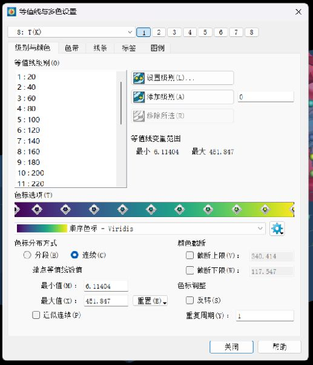

# Tecplot 360 EX 2025 R1 简体中文界面扩展

**非官方汉化插件，Windows x64，版本 v0.3.0。** 适用于 Tecplot 360 EX 2025 R1 **2025.1.0.72401 / Qt 5.15.2**。使用前需要已安装、可正常运行的 Tecplot。

[下载发布包](../../releases/latest) · [更新记录](CHANGELOG.md) · [验证说明](VALIDATION.md)

## 覆盖范围

词库包含 **1,608 个基础词条**，构建为 **7,774 个精确匹配及规范化查询项**；这些数字不是界面控件数，也不表示 100% 覆盖。

- 主菜单、文件菜单、远程加载、纸张设置、工具提示和常用按钮。
- 欢迎页入口、文档与在线资源链接、底部提示和版本标签。
- 绘图类型、等值线与多色设置、坐标轴、切片、等值面、流线、矢量、动画。
- 区域样式的标签与表头，以及标准列表、下拉框和表格枚举值的显示翻译。
- 有限元、CFD、数据导入导出、数据计算等常用术语。

**这是尽量扩大覆盖面的社区版本，仍可能有未收录文字、插件自绘界面或动态错误信息显示英文。** 品牌名、文件格式、变量符号、用户图中文字和文档正文不强制翻译。



## 安装

1. 下载 Releases 中的 `Tecplot-2025R1-zh-CN-v0.3.0-win64.zip`，解压到一个固定文件夹。
2. 退出 Tecplot，双击 `Install.cmd`。
3. 安装器优先读取桌面上的 `Tecplot 360 EX 2025 R1` 快捷方式；找不到时会要求选择 `bin/tec360.exe`。
4. 从原来的桌面快捷方式重新启动 Tecplot。

安装器会校验汉化文件 SHA256、应用版本和已验证 Qt DLL 的 SHA256。不同构建的 Qt 文件会被拒绝安装。安装目录若需要管理员权限，请使用有写入权限的终端运行安装脚本。

也可以显式指定目录：

```powershell
.\install.ps1 -TecplotRoot 'C:\Program Files\Tecplot\Tecplot 360 EX 2025 R1'
```

安装器新增 `bin/tecplot_zh_CN.dll`、`bin/tecplot_zh_CN.qm`，并在 `tecplot.add` 添加带标记的可选插件加载段。原配置备份在安装目录的 `.tecplot-zh-cn-backup` 中。

## 恢复英文

退出 Tecplot，双击 `Restore-English.cmd`，再重新启动。恢复脚本只停用本插件；当其他配置没有变化时，逐字节恢复原配置。DLL 和 QM 文件保留在原位置，方便再次安装。

## 机制与边界

插件使用 Tecplot Add-on 入口和随程序提供的 Qt 运行库。菜单、选项和表格主要在**显示层**翻译，保留 QAction 标题、模型项及实际枚举值，避免加载布局时重复创建菜单。

为覆盖原本未调用 Qt 翻译接口的文字，插件在当前进程中替换限定 UI 模块的文字绘制导入入口，以及 Qt 项目委托的显示方法。此实现依赖指定 Qt ABI，属于非官方兼容性扩展；退出 Tecplot 后这些内存修改自然消失。没有覆盖厂商 EXE/Qt DLL，没有修改许可，也没有网络上传功能。

- 图中的用户注释、公式和实际数据集内容保持原样。
- 与词库完全相同的用户自定义列表文字，可能仅在界面中显示译文；内部值和导出名称仍保留原文。必要时恢复英文核对。
- 部分窗口在约 0.75 秒后更新标题或标签。绘制时替换的中文受原控件宽度限制，长译文可能被裁切。
- 原快捷键保留；为避免窄菜单挤压，部分绘制文字不显示英文助记字母。
- 未逐一测试所有第三方插件、罕见错误、远程功能或大型 ODB 数据集。不能据此保证任意工作流兼容。

## 从源码构建

需要 Python 3 和 Zig 0.14.1（可从 [Zig 官方网站](https://ziglang.org/download/) 获取）。源码无需分发 Qt SDK 或 Tecplot DLL。

```powershell
.\build.ps1 -Zig 'C:\tools\zig\zig.exe' -Python 'python'
python .\test_catalog.py 'C:\Program Files\Tecplot\Tecplot 360 EX 2025 R1\bin'
python .\test_qt_abi.py 'C:\Program Files\Tecplot\Tecplot 360 EX 2025 R1\bin'
```

编辑 `translations.tsv` 添加译文；`source_strings.json` 保存可复现构建所需的匹配变体。`build_catalog.py` 生成 `catalog.json` 和 QM 文件。`build.ps1` 会同步更新 `manifest.json` 中汉化 DLL/QM 的 SHA256，并保留已验证的宿主运行库哈希。

默认日志只记录版本和初始化状态。开发排查时可在启动前设置环境变量 `TECPLOT_ZH_CN_DIAGNOSTICS=1` 收集未匹配文字；这些日志可能包含文件路径或用户界面数据，请勿直接公开上传。

## 反馈与贡献

请在 Issues 中提供 Tecplot 完整版本、对话框名称、原英文和建议译文。截图请遮盖个人路径、许可信息和研究数据。欢迎补充词条和复现步骤。

本项目不包含 Tecplot 安装程序、厂商 DLL、授权文件或破解工具，与 Tecplot 官方无关联。项目原创代码及说明采用 [MIT License](LICENSE)；Tecplot、Qt 及其商标归各自权利人所有。
